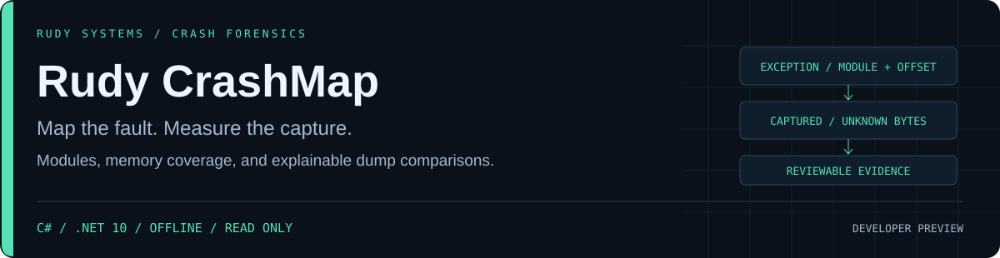

<p align="center"></p>

<p align="center">
<a href="https://github.com/r4venrudy/rudy-crashmap/actions/workflows/ci.yml"></a>

<a href="LICENSE"></a>
<a href="https://rudy.systems"></a>
</p>

**A crash address is useful only when you can explain which module contains it, which bytes were actually captured, and what changed between dumps.**

Rudy CrashMap is a C#/.NET 10 offline Windows user-mode minidump investigation tool. It validates supported binary metadata, maps exception and requested addresses to every matching module/capture/region, measures distinct captured coverage, and compares loaded-module metadata between captures. It produces local HTML, JSON, and readable text without loading dump code or resolving symbols.

Developer preview · bounded random-access parsing · unsigned 64-bit addresses · cross-platform analysis · no third-party NuGet dependencies.

## What it answers

| Question | Evidence |
| --- | --- |
| Where did the recorded exception occur? | Exception code/thread/address, matching module offsets, thread presence, and whether that byte is captured |
| What does this virtual address refer to? | Every overlapping module, captured range with file offset, and memory region; ambiguity stays visible |
| How much memory is really present? | A disjoint interval union that avoids counting overlapping stack/memory descriptors twice |
| Which executable regions deserve review? | Committed executable, private executable, and writable executable region counts and protection/type metadata |
| Did the loaded-module metadata change? | Added, removed, metadata-changed, relocated, and ambiguous-name groups; ASLR-only moves are reported separately |
| Can the result be reviewed offline? | RUDY HTML, structured JSON, SHA-256 input identities, omission counts, and explicit unsupported-stream coverage |

Executable private memory is common in legitimate JIT/runtime allocations. Module containment does not prove fault causality, binary metadata does not authenticate a file, and uncaptured bytes remain unknown. This is metadata triage, not malware classification or a debugger's stack trace.

## Install and investigate

Get a tested package from [Releases](https://github.com/r4venrudy/rudy-crashmap/releases), verify `SHA256SUMS.txt`, and extract it. Native-host packages include the .NET runtime for Windows x64, Linux x64, and macOS ARM64. Use `bin/crashmap` or `bin\crashmap.exe`; keep the entire `bin/` directory together.

Packages contain invented minidumps and expected results. These are generated from documented field layouts and contain no captured user process memory.

```sh
bin/crashmap inspect examples/synthetic/before.dmp
bin/crashmap inspect examples/synthetic/before.dmp --format html --output investigation.html
bin/crashmap locate examples/synthetic/before.dmp --address 0x140001010 --format json
bin/crashmap diff examples/synthetic/before.dmp examples/synthetic/after.dmp --format json --fail-on changed
```

The `.nupkg` release asset is an alternative for systems with a .NET 10 runtime. From a source checkout (which supplies `NuGet.Config`), download it into a local directory, then install without contacting a registry:

```sh
dotnet tool install Rudy.CrashMap.Tool --version 0.1.0-preview --tool-path .tools --add-source DOWNLOADED_PACKAGE_DIRECTORY --configfile NuGet.Config
.tools/crashmap --version
```

Use only authorized, stable evidence copies. Reports omit input filenames, complete module paths, PDB paths, context registers, exception parameter values, and raw memory. Basenames, path hashes, addresses, build identifiers, and timestamps can still be identifying; review reports before sharing. Existing outputs, source aliases, and symbolic links cannot be overwritten.

## Build and test

Install a .NET 10 SDK. Source build/test uses only the SDK/framework packs and the checked-in source. `NuGet.Config` disables package feeds; there are no third-party package references. Python 3.9+ with the standard library enables an independent fixture/CLI oracle and packaging.

```sh
dotnet build tests/CrashMap.Tests -c Release
dotnet run --project tests/CrashMap.Tests -c Release --no-build
dotnet build src/CrashMap.Cli -c Release
python tests/integration.py src/CrashMap.Cli/bin/Release/net10.0/crashmap.dll .
python examples/make_capture.py artifacts/synthetic
```

The native C# suite compares interval coverage against independent byte sets and tests a real DbgHelp minidump on Windows. That oracle starts and captures only its own temporary child process; its real dump is deleted and never packaged. Linux/macOS run the portable coverage tests and the independently generated format/CLI oracle. CI runs all three OS targets with warnings treated as errors.

Release builds run the same tests, publish each self-contained runtime for its own OS, test the installed layout, generate the invented examples/reports, and install/test the `.nupkg`. Packaging downloads Microsoft's runtime packs from the explicitly supplied official NuGet source. See [release validation](docs/VALIDATION.md).

## Supported format and limits

| Scope | Support |
| --- | --- |
| Container | Little-endian `MDMP`, format low word `0xa793`, standard flags through `0x01ffffff` |
| Parsed streams | SystemInfo, ModuleList, ThreadList, MemoryList, Memory64List, Exception, MemoryInfoList |
| Module identity hints | Basename, size, checksum field, timestamp, RSDS PDB GUID/age, full-path SHA-256 |
| Contexts and other streams | Known nested extents are checked; context contents and unknown-stream bodies are not decoded |
| Input | 512 MiB default; up to 4 GiB through `--max-input-mib` |
| Metadata | 100,000 total items default; up to 1,000,000 through `--max-items`; at most 256 directory entries and 16 MiB per supported stream |
| Strings | 8 KiB per UTF-16 string; 16 MiB aggregate decoded string bytes, including repeated references |
| Display | 100 rows per collection default; up to 1,000 through `--rows`; 16 MiB report ceiling |
| Output | New file only; `0600` on POSIX, inherited directory permissions on Windows |

All virtual ranges are checked for overflow; file extents are checked before reads. SHA-256 is computed before and after parsing. These checks do not establish authenticity, acquire a live process snapshot, or form an OS sandbox against a hostile filesystem. Source copies must already be stable. Coverage queries use sorted interval unions and prefix sums rather than nested range scans.

## Gates and exit codes

| Exit | Meaning |
| --- | --- |
| `0` | Supported analysis completed and the requested gate was not reached |
| `1` | `inspect --fail-on private-executable` or `diff --fail-on changed` reached its explicit review gate |
| `2` | Invalid arguments/metadata, unsupported encoding, resource limit, unstable source, or I/O failure |

`changed` includes added/removed/changed metadata and ambiguous groups. Pure relocation does not reach it. Duplicate basenames are never paired arbitrarily. Case-insensitive basenames are grouping hints; path changes alone are not compared, and matching metadata does not prove identical binaries. Totals cover the full parsed input even when displayed rows are omitted.

CrashMap does not attach to processes, collect arbitrary dumps, unwind stacks, decode registers, download symbols, load modules, disassemble code, verify signatures, inspect Windows kernel/BSOD dumps, decompress future formats, or prove a security incident. The minidump header checksum is reported as unverified. Unknown stream types are listed rather than treated as analyzed.

## Design and evidence

- [Binary parser and coverage design](docs/DESIGN.md)
- [Report contract](docs/REPORTS.md)
- [Validation and preview limits](docs/VALIDATION.md)
- [Synthetic scenario](examples/README.md)
- [Security boundaries](SECURITY.md) · [Contributing](CONTRIBUTING.md)

**RUDY Systems · Crash forensics** · [Project home](https://rudy.systems) · [MIT license](LICENSE)
